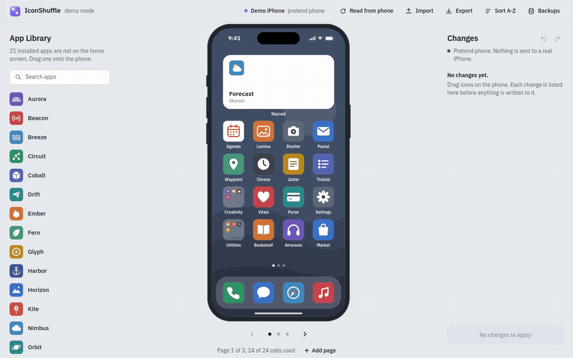
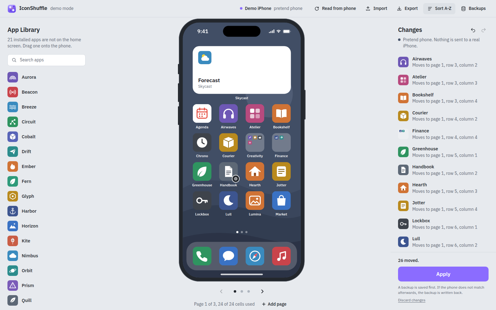

<p align="center">

</p>

<h1 align="center">IconShuffle</h1>

<p align="center">
<b>iPhone ana ekranınızı bilgisayardan düzenleyin.</b><br>
Telefonunuzun canlı aynasında gerçek simgelerinizi sürükleyin ya da ne istediğinizi yapay zekâ asistanınıza söyleyin.<br>
Windows, macOS ve Linux · USB ya da Wi-Fi · Mac, jailbreak ya da hesap gerekmez.
</p>

<p align="center">
<a href="https://github.com/YakupEmreYerli/IconShuffle/releases/latest"></a>
<a href="https://github.com/YakupEmreYerli/IconShuffle/releases/latest"></a>
<a href="https://github.com/YakupEmreYerli/IconShuffle/releases/latest"></a>
</p>

<p align="center">
<a href="https://github.com/YakupEmreYerli/IconShuffle/actions/workflows/ci.yml"></a>
<a href="LICENSE"></a>
<a href="https://iconshuffle.app"></a>
</p>

<p align="center"><a href="https://iconshuffle.app">Web sitesi</a> · <a href="docs/agent-guide.md">Asistan rehberi</a> · <a href="README.md">English</a></p>



Altı inçlik ekranda altmış simgeyi tek tek sürüklemek, üstelik simgeler titreyip birbirini
sonraki sayfaya iterken, kimsenin sevdiği bir iş değil. IconShuffle ana ekranınızı gerçek
simgeleri, klasörleri ve widget'larıyla bilgisayarın büyük ekranına taşır; düzeni orada
kurarsınız. Uygula'ya basmadan telefona hiçbir şey gitmez. Her yazmadan önce yedek alınır,
yazmadan sonra telefon yeniden okunur ve planla uyuşmazsa eski düzen kendiliğinden geri
yüklenir.

## Kurulum

**Windows** (PowerShell):

```powershell
irm https://iconshuffle.app/install.ps1 | iex
```

**macOS ve Linux:**

```bash
curl -fsSL https://iconshuffle.app/install.sh | sh
```

Betikler bu depodaki son sürümü indirip kurar. İsterseniz önce okuyun:
[`install.ps1`](install.ps1), [`install.sh`](install.sh). Kurulum dosyasını kendiniz de
[sürümler sayfasından](https://github.com/YakupEmreYerli/IconShuffle/releases/latest)
indirebilirsiniz: `IconShuffle-*-windows-x64-setup.exe`, `IconShuffle-*-macos-arm64.dmg`
ya da `IconShuffle-*-linux-x86_64.AppImage`.

Terminali mi seviyorsunuz? Komut satırı aracı bir Python paketi:

```bash
uv tool install git+https://github.com/YakupEmreYerli/IconShuffle
# ya da
pipx install git+https://github.com/YakupEmreYerli/IconShuffle
```

Kurulum dosyaları henüz imzalı değil, bu yüzden ilk açılışta bir tıklama fazladan gerekir.
macOS'ta: Sistem Ayarları → Gizlilik ve Güvenlik → **Yine de Aç**. Windows'ta SmartScreen
bir kez sorabilir: **Ek bilgi → Yine de çalıştır**.

## Üç kullanım yolu

**Uygulama.** IconShuffle'ı açın ve iPhone'u takın. Ana ekranınızı kendi simgeleri ve duvar
kâğıdıyla görürsünüz. Uygulamaları sayfalar arasında ve dock'a sürükleyin, klasör yapmak
için bir uygulamayı ötekinin üstüne bırakın, App Library'den uygulama çekin ya da
**A-Z sırala**'ya basın. Sağ taraf her değişikliği sade bir dille listeler. **Uygula**
hepsini yazar.

**Yapay zekâ asistanınız.** Claude Code, Codex, Cursor ya da başka bir kodlama asistanı
bütün işi sizin yerinize yapabilir. Şunu yapıştırın, sonuna kendi isteğinizi yazın:

```text
https://github.com/YakupEmreYerli/IconShuffle/blob/main/docs/agent-guide.md dosyasını oku
ve ios-homescreen ile iPhone ana ekranımı düzenlememe yardım et. Gerekiyorsa kur, telefona
bir şey yazmadan önce her değişikliği bana göster ve onayımı bekle. İstediğim: iş
uygulamalarımı tek bir klasöre koy, oyunları 2. sayfaya taşı.
```

[Asistan rehberi](docs/agent-guide.md) asistana aracı nasıl kurup kullanacağını anlatır;
telefona bir şey yazmadan önce değişiklikleri size göstermesi ve onayınızı beklemesi
gerektiğini de söyler. Telefonu takmak ve Güven'e dokunmak yine size kalır. Claude Code
için aynı akışı izleyen bir skill de var: [`skills/ios-homescreen`](skills/ios-homescreen)
klasörünü `~/.claude` içindeki `skills` klasörüne (ya da projenin `.claude` klasöründeki
`skills` klasörüne) kopyalayın.

**Terminal.** Düzeniniz düz bir TOML dosyası. Okuyun, istediğiniz editörde düzenleyin, yazın:

```bash
ios-homescreen pull        # telefonu layout.toml dosyasına okur (yalnız okur)
ios-homescreen check       # neyin değişeceğini gösterir (bağlantısız)
ios-homescreen push        # sorar, yedekler, yazar, doğrular, gerekirse geri alır
```

## Güvenlik baştan düşünüldü

Ana ekran protokolünün belgesi yok ve hata affetmiyor. Bu yüzden IconShuffle göremediği bir
yazmaya asla güvenmez:

- **Önce yedek.** Her yazma, telefona dokunmadan önce mevcut düzeni kaydeder.
- **Her seferinde geri okuma.** Yazmadan sonra telefon yeniden okunur ve simge simge planla
  karşılaştırılır.
- **Kendini geri alır.** Telefon planla uyuşmazsa yedek kendiliğinden geri yüklenir.
  `ios-homescreen restore latest` herhangi bir yazmayı sonradan da geri alır.
- **Yazmadan önce sorar.** Uygulamada, terminalde ya da asistanla, değişikliklerin tam
  listesini görürsünüz ve onayınız olmadan hiçbir şey yazılmaz.
- **Bilgisayarınızda kalır.** Düzenleyici yalnız 127.0.0.1 üzerinde çalışır; düzenler,
  simgeler ve yedekler bilgisayarınızdan çıkmaz. Hesap ve kullanım verisi toplama yok.

Ayrıntılar [Güvenlik modeli](#güvenlik-modeli) bölümünde.

## Platformlar

| | Gerekenler | Durum |
| --- | --- | --- |
| **Windows 10 ve 11** (64 bit) | Microsoft Store'dan [Apple Devices](https://apps.microsoft.com/detail/9np83lwlpz9k) (ya da iTunes): USB sürücüsünü o getirir | Beta |
| **macOS** (Apple silicon) | Ek bir şey gerekmez | Beta |
| **Linux** | Kurulu ve çalışan `usbmuxd` (`sudo apt install usbmuxd`, `sudo dnf install usbmuxd`, `sudo pacman -S usbmuxd`) | Kararlı |

Motor her sistemde aynı ve testleri üç sistemde de çalışıyor. Windows ve macOS'u beta diye
işaretledik, çünkü henüz çok sayıda gerçek iPhone'la buluşmadılar. IconShuffle'ı bu
sistemlerde denerseniz, çalıştığını (ya da çalışmadığını) anlatan bir
[issue](https://github.com/YakupEmreYerli/IconShuffle/issues) çok işe yarar.

Her sistemde gereken tek şey bilgisayara güvenen bir iPhone: telefonu bir kez kabloyla
bağlayın, kilidini açın, **Bu Bilgisayara Güven**'e dokunun ve parolanızı girin. Wi-Fi,
USB üzerinden bir kerelik kurulumdan sonra iOS 17 ve üstünde çalışır. Root ya da
Geliştirici Modu gerekmez.

## Özellikler

- Dock'u, sayfaları, klasörleri (birden çok sayfalı klasörler dahil), widget'ları, widget
  yığınlarını, web kliplerini, Safari web uygulamalarını ve boşaltılmış uygulamaları okur;
  yalnız App Library'de duran uygulamaları listeler.
- Telefona bir şey yazmadan önce neyin taşınacağını, neyin App Library'ye gideceğini ve
  neyin geri geleceğini gösterir.
- Düzeni telefona dokunmadan önce denetler: bilinmeyen ya da iki kez geçen öğe, dolu dock,
  24 hücreyi aşan sayfa (widget'lar boyutlarıyla sayılır), boş ya da iç içe klasör,
  klasörde widget.
- Düzene koymadığınız uygulamalar App Library'ye gider ve orada kalır.
- Her sayfayı tek tıkla A-Z sıralar; dock, klasör içleri ve widget'lar yerinde kalır.
- Telefon okunduktan sonra değiştiyse yazmayı reddeder.
- Her komutta betikler ve asistanlar için JSON çıktısı var, komut satırının altında da bir
  Python API'si (`ios_homescreen.api`) duruyor.
- Okuma kayıtlarını ve yedekleri kendi veri klasöründe tutar; yalnız düzen dosyası sizin
  gösterdiğiniz yere gider.

Komutun adı `ios-homescreen`, Python paketinin adı `ios_homescreen`. Bu adlar projenin ilk
aylarından kaldı ve değişmiyor; böylece onlara dayanan betikler ve araçlar çalışmaya devam
ediyor.

Geliştirmek için depodan:

```bash
git clone https://github.com/YakupEmreYerli/IconShuffle
cd IconShuffle
uv sync
uv run ios-homescreen --help
```

## Hızlı başlangıç

```bash
# 1. Telefonu layout.toml dosyasına çek. Yalnız okur, telefona hiçbir şey yazmaz.
ios-homescreen pull

# 2. Dosyayı düzenle: satırları taşı, sondaki listeden uygulama ekle, klasör kur.
$EDITOR layout.toml

# 3. Neyin değişeceğine bak. Telefona bağlanmaz.
ios-homescreen check

# 4. Yaz. push değişiklikleri gösterip sorar; sonra yedek, yazma, doğrulama, gerekirse geri dönüş.
ios-homescreen push
```

Bir `push` komutunu geri almak için aldığı yedeği geri yazın:

```bash
ios-homescreen restore latest
```

## Komutlar

| Komut | Ne yapar | Telefona bağlanır mı |
| --- | --- | --- |
| `pull [LAYOUT]` | Ana ekranı bir düzen dosyasına (varsayılan `layout.toml`) yazar, telefonun o anki hâlini de kayıt olarak saklar | Yalnız okur |
| `check [LAYOUT]` | Dosyayı denetler, `push` komutunun pull kaydına göre neyi değiştireceğini listeler | Hayır |
| `sort [LAYOUT]` | Dosyadaki sayfaların uygulama ve klasörlerini A'dan Z'ye sıralar; dock, klasör içleri ve widget'lar yerinde kalır | Hayır |
| `push [LAYOUT]` | Değişiklikleri gösterip sorar; sonra yedek alır, yazar, doğrular, tutmazsa geri döner | Yazar |
| `apps [QUERY]` | Kurulu uygulamaları paket kimlikleri ve her birinin şu anki yeriyle listeler (en yeni pull kaydından) | Hayır |
| `editor` | Tarayıcı düzenleyicisini 127.0.0.1 üzerinde açar | Okur; yalnız Uygula'ya basınca yazar |
| `backups` | Her yazmadan önce alınan yedekleri listeler: ne zaman, hangi iPhone, düzende ne vardı | Hayır |
| `restore BACKUP` | Bir yedeği (`latest`, `backups` listesindeki bir ad ya da bir dosya) `push` ile aynı adımlarla geri yazar | Yazar |
| `wifi setup\|status\|off` | Telefona Wi-Fi erişimini kurar, denetler ya da kapatır | Evet |

`pull`, henüz telefona yazmadığınız değişiklikler taşıyan bir düzen dosyasının üstüne yazmaz;
başka bir dosyaya çekin ya da `--overwrite` verin. `check`, `sort` ve `push` komutları
`--allow-removal` alır (düzen dosyası bölümüne bakın); `push` ve `restore` komutları
`--force` alır (güvenlik bölümüne bakın). `backups` en yeni 20 yedeği gösterir, `--all`
hepsini listeler. `wifi` dışındaki bütün komutlar `--data-dir DIR` alır; `push`,
`restore`, `editor` ve `backups` ayrıca `--backup-dir DIR` alır. `editor` dışındaki bütün
komutlar `--json` alır ve stdout'a tek bir JSON nesnesi yazar; betikler ve asistanlar için
olan bu çıktıyı [asistan rehberi](docs/agent-guide.md) anlatır. `--json` ile `push` ve
`restore` hiçbir şey sormaz: `--yes` yoksa yalnız neyin değişeceğini bildirir.

Bağlantı seçenekleri (`pull`, `push`, `restore`, `editor`, `wifi`):

| Seçenek | Anlamı |
| --- | --- |
| *(yok)* | usbmuxd üzerinden USB |
| `--wifi` | Wi-Fi (iOS 17 ve sonrası); önce bir kez USB üzerinden `wifi setup` çalıştırın |
| `--udid UDID` | Birden çok cihaz bağlı ya da eşliyse birini seçer |
| `--discovery-timeout SECONDS` | Bonjour cevaplarının bekleneceği süre (varsayılan 5) |
| `--connect-timeout SECONDS` | Bağlantı kurma süre sınırı (varsayılan 30) |

Yazma seçenekleri (`push`, `restore`; `--yes` dışındakiler `editor` için de geçerli):

| Seçenek | Anlamı |
| --- | --- |
| `-y`, `--yes` | Sormadan yazar. Soracak bir terminal yoksa (betik, boru hattı) gerekir |
| `--backup-dir DIR` | Otomatik yedeğin yeri (varsayılan `DATA_DIR/backups`) |
| `--verify-attempts N` | Yazmayı doğrulamak için yeniden okuma sayısı (varsayılan 6) |
| `--verify-interval SECONDS` | Bu okumalar arasındaki bekleme (varsayılan 3) |
| `--write-timeout SECONDS` | Düzeni gönderme süre sınırı (varsayılan 10) |
| `--read-timeout SECONDS` | Her okumanın süre sınırı (varsayılan 30) |

Çıkış kodları: `0` tamam (ya da yapılacak bir şey yok); `1` hata, hiçbir şey yazılmadı
(telefonun pull komutundan sonra değişmesi de buna girer); `2` kullanım hatası ya da yazma
onaylanmadı (hayır dediniz, ya da terminal yoktu ve `--yes` verilmedi); `3` yeni düzen
doğrulanamadı ve yedek geri yazıldı; `4` o da doğrulanamadı. Yedek dosyası her durumda kalır.

## Düzen dosyası

Düzende bir `[dock]` tablosu ve her sayfa için bir `[[pages]]` tablosu olur. Her birinde
ana ekran sırasıyla (soldan sağa, yukarıdan aşağı) bir `items` dizisi bulunur.

```toml
[dock]
items = ["Phone", "Safari", "Messages", "Camera"]

[[pages]]
items = [
  { type = "widget", id = "6F1D3A52-0000-4000-8000-000000000001" },  # Hava Durumu, orta boy
  "com.apple.mobilecal",        # Takvim, paket kimliğiyle
  "Mail",                       # ya da simgenin altındaki adla
  { type = "folder", name = "Utilities", items = ["Calculator", "Voice Memos", "Find My"] },
  { type = "folder", name = "Media", pages = [["Music", "Podcasts", "TV"], ["Books"]] },
  { type = "webclip", id = "0A1B2C3D4E5F40718293A4B5C6D7E8F9" },  # bir Safari yer imi
  { type = "webapp", id = "9E8D7C6B-0000-4000-8000-000000000002" },  # bir Safari web uygulaması
]

[[pages]]
items = ["Health", "Wallet"]
```

Uygulama adları telefonun diline göre değişir; Türkçe telefonda `"Takvim"`, `"Hesap Makinesi"`
gibi adlar yazılır. Paket kimliği her dilde aynıdır.

[`examples/layout.toml`](examples/layout.toml) Apple'ın hazır uygulamalarıyla yazılmış tam bir
örnek. Siz kendi dosyanıza `pull` ile başlayın: gerçek kimlikleri doldurur, her öğenin adını
yorum olarak ekler ve yalnız Uygulama Arşivi'nde duran uygulamaları dosyanın sonuna, bir
sayfaya kopyalanmaya hazır biçimde yazar.

Çekilen dosyanın başındaki `[pull]` tablosu, dosyanın hangi kayıttan geldiğini söyler
(`DATA_DIR/pulls` içindeki `snapshot = "pull-....plist"`). `check` ve `push` dosyayı bu
kayıtla karşılaştırır; tabloya dokunmayın. Tablosu olmayan bir dosya en yeni kayıtla
karşılaştırılır. Başarılı bir `push` telefonun yeni hâlini kaydeder ve tabloyu ona çevirir;
böylece dosya ile telefon yeniden aynı düzeni anlatır.

| Öğe | Nasıl yazılır | Not |
| --- | --- | --- |
| Uygulama | `"com.apple.Maps"` ya da `"Maps"` | Paket kimliği ya da, o adda tek uygulama varsa, adı. `{ type = "app", id = "com.apple.Maps" }` de olur ve yalnız kimlik kabul eder. Yalnız Uygulama Arşivi'nde duranlar dahil kurulu her uygulama eklenebilir. |
| Klasör | `{ type = "folder", name = "İş", items = [...] }` | Çok sayfalı klasör için `items` yerine `pages = [[...], [...]]`. İçine uygulama, web kısayolu ve web uygulaması konur. |
| Widget ya da widget yığını | `{ type = "widget", id = "..." }` | Küçük 4 hücre, orta 8, büyük 16. Dock'a ve klasöre konamaz. |
| Web kısayolu | `{ type = "webclip", id = "..." }` | Ana Ekrana Ekle ile eklenen yer imi. Taşınabilir, kaldırılamaz (aşağıya bakın). |
| Safari web uygulaması | `{ type = "webapp", id = "..." }` | Ana Ekrana Ekle'de "Web Uygulaması Olarak Aç" seçilerek eklenen site (iOS 26 ve sonrası). Safari'nin paket kimliğini taşır ama kendi kimliği vardır; Safari'den ayrı bir öğedir. Taşınabilir, kaldırılamaz. |
| Fazladan uygulama simgesi | `{ type = "webapp", id = "..." }` | Yüklü bir uygulamanın ikinci simgesi: uygulamanın paket kimliğini taşır, kendi kimliği vardır. Düzen dosyasında `extra icon` diye geçer. Taşınabilir, kaldırılamaz. |

Planlayıcının uyguladığı kurallar:

- Dock'a en çok 4 öğe sığar. Bir sayfa 24 hücredir; uygulama, klasör, web kısayolu ve web
  uygulaması birer hücre tutar.
- Her öğe bir kez geçer. Aynı uygulamanın iki widget'ı, kimlikleri farklı iki ayrı öğedir.
- Klasörün adı ve en az bir öğesi olmalı; içinde klasör ya da widget olamaz.
- Widget, web kısayolu ve web uygulaması taşınabilir ama düzen dosyasıyla yeni oluşturulamaz.
  Telefondaki kimlikleriyle anılırlar ve planlayıcı telefonun kendi verisini olduğu gibi
  kopyalar. Bir widget'ı düzene yazmazsanız `check` ve `push` komutlarına `--allow-removal`
  vermedikçe hata alırsınız.
- Web kısayolları ve Safari web uygulamaları yazarak hiç kaldırılamaz. Yazılan düzende biri
  eksikse telefon onu yeni bir son sayfaya geri koyuyor; yazmadan sonraki denetim tutmuyor ve
  yedek geri yükleniyor. Bu yüzden planlayıcı böyle bir düzeni `--allow-removal` verilse de
  reddeder (kod `not_removable`). Bunları telefonda silin (simgeye basılı tutun, Yer İşaretini
  Sil), sonra yeniden `pull` çalıştırın.
- Düzende olmayan her kurulu uygulama Uygulama Arşivi'ne gider.
- Bilinmeyen anahtar hata sayılır; `itmes` gibi bir yazım hatası bir sayfayı sessizce boşaltmaz.

`check` (ve bağlanmadan önce `push`) bulduğu her sorunu yeriyle birlikte yazar, örneğin
`page 2, item 5: unknown app 'Mpas'`. Neyin değişeceğini de düz bir dille listeler:

```text
layout.toml is valid.
Changes compared with the pull from iPhone (iPhone 15, iOS 27.0) on 2026-10-10 14:44:

  Camera          moves from the dock to page 2, position 1
  Tips            comes from the App Library to page 2, position 2
  Folder "Tools"  was "Utilities"

1 moved, 1 added and 1 renamed.
30 apps will be only in the App Library.
```

## Düzenleyici



Masaüstü uygulaması düzenleyiciyi kendi penceresinde açar; `ios-homescreen editor` aynı
düzenleyiciyi tarayıcıda açar. Düzenleyici telefonu okur; telefonun uygulama simgelerini ve
telefon gönderiyorsa duvar kâğıdını gösterir. Uygulamaları,
klasörleri ve widget'ları ana ekranın resmi üzerinde, sayfalar arasında ve dock'a
sürükleyebilirsiniz. Bir uygulamayı ötekinin üstüne bırakınca klasör olur; klasöre tıklayınca
açılır, adını orada değiştirir, içine uygulama atar ya da çıkarırsınız. Soldaki Uygulama
Arşivi, kurulu olup ana ekranda olmayan uygulamaları gösterir: oradan ana ekrana sürükleyin ya
da ana ekrandan kaldırmak istediklerinizi oraya bırakın. Sağ tarafta son okumaya göre değişen
her şey listelenir; düzen siz çalışırken `check` ile aynı kurallarla denetlenir.

Widget'lar gerçek boyutlarında, uygulamalarının simgesi ve adıyla görünür; bir yığın kaç
widget taşıdığını gösterir. Telefon widget'ın içinde ne gösterdiğini göndermiyor, düzenleyici
de bunu uydurmuyor.

Uygula önce onay ister, sonra `push` ile aynı adımlardan geçer: yedek, yazma, geri okuma,
tutmazsa geri dönüş. İlerleme ve sonuç sayfada görünür. Yedekler, otomatik alınan yedekleri
listeler ve birini aynı yolla geri yükler. İçe ve Dışa Aktar TOML düzen dosyasını yükler ve
kaydeder; düzenleyiciyle metin düzenleyicisi arasında gidip gelebilirsiniz. Dışa aktarılan
dosya `check` ve `push` ile de çalışır.

```bash
ios-homescreen editor          # USB ile; Wi-Fi için --wifi ekleyin
ios-homescreen editor --demo   # uydurma uygulamalı bir deneme iPhone'u
```

| Seçenek | Anlamı |
| --- | --- |
| `--port PORT` | 127.0.0.1 üzerindeki port (varsayılan: boş herhangi bir port) |
| `--no-browser` | Yalnız adresi yazar, tarayıcı açmaz |
| `--demo` | Deneme iPhone'u kullanır; hiçbir telefona bağlanmaz, kayıtlar ve yedekler geçici bir klasöre gider |

Bağlantı ve yazma seçenekleri `push` komutundaki gibi çalışır. `--yes` gerekmez, düzenleyici
kendisi sorar.

Düzenleyici yalnız 127.0.0.1'i dinler. Yazdığı adreste her açılışta değişen bir anahtar var;
sayfa bu anahtarı bir çereze çevirir. Her istek anahtarı taşımalı ve sayfanın kendisinden
gelmeli. Böylece aynı tarayıcıda açık başka siteler düzenleyiciyi kullanamaz; simgelerinizi,
duvar kâğıdınızı ve yedeklerinizi göremez. Bir widget'ı kaldırmak, `--allow-removal` gibi ayrı bir onay ister.
Ctrl+Z geri alır, Ctrl+Shift+Z yineler.

## Güvenlik modeli

Ana ekran protokolü belgelenmemiş. Araç yazılırken iki davranışı gerçek bir telefonda düzeni
bozdu; tasarım bu ikisinin etrafından dolaşıyor.

1. Telefona hangi uygulamaların ana ekranda olmayacağı söylenmeli. `setIconState` yalnız
   sayfa listesi alırsa SpringBoard, listede olmayan her kurulu uygulamayı (Uygulama Arşivi'ndekiler
   ve Apple'ın hazır uygulamaları dahil) ana ekranın sonuna ekliyor. IconShuffle her zaman
   `{buttonBar, iconLists, ignored}` gönderir; `ignored`, ana ekranda olmayan bütün kurulu User
   ve System uygulamalarının listesidir. Bu liste yazma anında kurulu uygulamalardan yeniden
   hesaplanır.
2. Yazmanın güvenilir bir cevabı yok. SpringBoard `setIconState` isteğine çoğu zaman cevap
   vermiyor, pymobiledevice3'ün `set_icon_state` fonksiyonu da bu cevabı sonsuza kadar bekliyor.
   IconShuffle isteği kendisi, süre sınırıyla gönderir ve cevap gelmemesini "belirsiz" sayar.
   Kanıt, telefonun yeniden okunan düzeninin gönderilenle aynı çıkmasıdır.

Her `push` ve `restore` aynı adımlardan geçer:

1. Dosyayı bağlanmadan önce denetler. Sorunlu bir düzen telefona hiç gitmez.
2. Bağlanır ve düzeni okur. Düzen, dosyanın çekildiği kayıttan farklıysa (telefon arada
   değiştiyse) `push` durur; `--force` yine de yazar. Yedek başka bir iPhone'da alınmışsa
   `restore` durur; `--force` yine de geri yazar.
3. Neyin değişeceğini gösterir ve sorar. Yalnız `y` ya da `yes` devam ettirir. Soracak bir
   terminal yoksa `--yes` gerekir; verilmezse komut bağlanmadan 2 koduyla çıkar.
4. Düzeni yeniden okur ve iPhone'un adı ve UDID'siyle birlikte zaman damgalı yedek olarak
   kaydeder. Telefonun değişip değişmediği bu okumada bir kez daha denetlenir.
5. Düzeni süre sınırıyla gönderir.
6. Düzeni yeni bir bağlantıyla en çok `--verify-attempts` kez yeniden okur ve gönderilenle
   karşılaştırır: her sayfada ve her klasörde öğe türleri, kimlikleri ve sırası.
7. Hiç tutmazsa yedeği aynı yolla geri yazar ve onu da doğrular.

Kayıtlar ve yedekler ikili plist olarak saklanır, çünkü düzende JSON'un kaybedeceği tarih ve
ikili veri var.

## Wi-Fi

Wi-Fi için iOS 17 ya da sonrası gerekir. Telefon USB ile bağlıyken bir kez kurun:

```bash
ios-homescreen wifi setup      # USB üzerinden, bir kez
ios-homescreen wifi status     # ayar, eşleşme ve telefonun Wi-Fi'de cevap verip vermediği
```

`wifi setup` telefondaki Wi-Fi bağlantısı ayarını açar ve bu bilgisayarı Wi-Fi için
RemotePairing ile eşler; Xcode kablosuz cihazlar için aynı yolu kullanır. Bilgisayar USB
üzerinden zaten güvenilir olduğu için telefonda bir soru çıkmaz. Root, Geliştirici Modu ya da
ayrı bir tünel servisi gerekmez: bağlantı, pymobiledevice3'ün IconShuffle sürecinin içinde
çalışan ağ yığınından geçer.

Bundan sonra `pull`, `push`, `restore` ya da `editor` komutuna `--wifi` ekleyin. Telefon
bilgisayarla aynı ağda, uyanık ve kilidi açık olmalı. IconShuffle telefonu
`--discovery-timeout` saniye boyunca Bonjour ile (`_remotepairing._tcp`) arar ve adresinden
değil eşleşmeden tanır; iOS özel ve değişen Wi-Fi adresleri kullanıyor. Bilgisayar birden çok
telefonla eşliyse `--udid` verin.

Telefon dinlemeye devam ettiği halde Bonjour cevapları bir süre gelmeyebiliyor. Bu yüzden
ios-homescreen her başarılı Wi-Fi bağlantısından sonra telefonun cevap verdiği adresi ve portu
hatırlar; bir sonraki bağlantıda Bonjour ile ararken o adrese doğrudan da bağlanmayı dener ve
hangisi önce cevap verirse onu kullanır. Adresler önbellek klasöründeki `wifi-addresses.json`
dosyasında durur; dosyayı silmek yalnız bir sonraki bağlantının Bonjour'a kalmasına yol açar.

Eşleşme, pymobiledevice3'ün tuttuğu bir dosyadır: `~/.local/share/pymobiledevice3/remote_<UDID>.plist`,
ya da bu klasör zaten varsa `~/.pymobiledevice3/`. İçinde bu bilgisayarın telefonla
konuşmasını sağlayan anahtar var; IconShuffle onu hiçbir yere kopyalamaz ve göndermez.
`wifi off` telefondaki ayarı kapatır, `wifi off --forget` eşleşme dosyasını da siler.

Telefona ağ üzerinden ulaşmanın eski yolu (62078 portundaki lockdown, `_apple-mobdev2._tcp`
olarak bulunur) kullanılmıyor: güncel iOS sürümleri bu bağlantıyı kabul ediyor ama ilk istekte
her servisi kapatıyor.

## Dosyalar ve ortam değişkenleri

Aşağıdaki yollar Linux içindir. macOS'ta veriler `~/Library/Application Support/ios-homescreen`,
önbellek `~/Library/Caches/ios-homescreen` altına gider. Windows'ta ikisi de
`%LOCALAPPDATA%\ios-homescreen` altındadır, önbellek onun `Cache` klasöründe durur.

| Ne | Varsayılan | Değiştirmek için |
| --- | --- | --- |
| Pull kayıtları ve yedekler | `$XDG_DATA_HOME/ios-homescreen` ya da `~/.local/share/ios-homescreen` | `--data-dir`, `IOS_HOMESCREEN_DATA_DIR` |
| Uygulama simgeleri ve duvar kâğıdı (tarayıcı düzenleyicisi), telefonun son Wi-Fi adresi | `$XDG_CACHE_HOME/ios-homescreen` ya da `~/.cache/ios-homescreen` | `IOS_HOMESCREEN_CACHE_DIR` |
| Wi-Fi eşleşmesi (pymobiledevice3) | `$XDG_DATA_HOME/pymobiledevice3` ya da `~/.local/share/pymobiledevice3` | `XDG_DATA_HOME` |

Veri klasöründe `pulls/pull-*.plist` (`pull`, `push` ve düzenleyicinin telefondan
okudukları) ve `backups/backup-*.plist` bulunur. Başka bir yere yazılan tek dosya, `pull`
komutunun yazdığı düzen dosyasıdır: çalışma klasöründe `layout.toml` ya da sizin verdiğiniz yol.

## Python API

```python
import asyncio
from ios_homescreen import api


async def main():
    device = await api.connect(api.Transport())  # Wi-Fi için api.Transport(wifi=True)
    try:
        snapshot = await api.read_device(device)  # pull'un okuduğu
        text = api.export_layout(snapshot)  # TOML düzen dosyası
        plan = api.plan_layout(text, snapshot)  # check'in yaptığı; sorun varsa api.LayoutError
        print(plan.changes)
        result = await api.push(
            device,
            plan,
            backup_dir=api.data_dir() / "backups",
            on_event=lambda event: print(event.message),
        )
        print(result.status)
    finally:
        await device.close()


asyncio.run(main())
```

İlerleme, değişmeyen bir `code` alanı taşıyan `Event` nesneleriyle gelir. Sonuçların ve
hataların `to_dict()` metodu ve makinenin okuyabileceği kodları var. `api.describe(snapshot)`
bir arayüz için JSON'a hazır bir görünüm verir, `api.to_document(view)` düzenlenmiş görünümü
yeniden düzene çevirir; `plan.change_list` değişiklikleri veri olarak tutar. `api.save_pull`,
`api.list_backups`, `api.find_backup` ve `api.restore` veri klasörüyle komut satırının
çalıştığı gibi çalışır; `api.fetch_icons` uygulama simgelerini PNG baytları olarak döndürür.

## Sınırlar

- Gizli ana ekran sayfaları normal sayfa gibi okunur ve bir yazma onları yeniden görünür yapar:
  SpringBoard'un okuması sayfa gizli de olsa aynı geliyor (iOS 27.2'de denendi); bu yüzden
  IconShuffle gizli sayfayı ayırt edemez, gizli tutamaz ve sayfa gizleyemez.
- Bugün görünümü ve Kilitli Ekran widget'ları ana ekran düzeninin parçası değil, kapsam dışında.
- Widget taşınabilir ya da kaldırılabilir ama oluşturulamaz. Web kısayolu ve Safari web
  uygulaması yalnız taşınabilir; onları telefonda silin.
- Düzen yazınca, ne göstereceğini sizin seçtiğiniz widget'lar (örneğin bir yığında seçili
  widget) varsayılan seçime dönebilir: SpringBoard yazma sırasında bu seçimi bırakıyor (iOS 27'de
  görüldü). Yazmadan sonraki denetim de bu yüzden bu seçime bakmaz.
- Simgeler arasında bıraktığınız boşluklar korunmaz. SpringBoard her sayfayı hücre konumu
  olmadan sıralı bir liste olarak gönderiyor; bu yüzden bir yazma, değiştirmediğiniz sayfalar
  dahil her sayfadaki boşlukları kapatabilir (iOS 26'da görüldü).
- Wi-Fi için iOS 17 ya da sonrası gerekir.
- Tarayıcı düzenleyicisi telefonun duvar kâğıdını yalnız SpringBoard gönderirse gösterir.
  iOS 27'de Wi-Fi üzerinden telefon bu isteği kapatıyor (iOS 27.0.1'de görüldü); düzenleyici
  o zaman düz bir arka plan kullanır. Görüntü almanın tek başka yolu, simgeleriyle birlikte
  ana ekranın ekran görüntüsü; o da arka plan olarak kullanılamaz.
- Boş sayfalar yazılmaz; SpringBoard onları tutmuyor. iPhone en fazla 15 sayfa tutar; daha
  fazla sayfalı bir düzen telefona dokunmadan reddedilir.
- Sayfa kapasitesi iPhone ızgarasına (6'ya 4) göre hesaplanır. iPad'de denenmedi.
- Düzen biçimi Apple'ın ve belgelenmemiş; bir iOS güncellemesi onu değiştirebilir.
  Güncellemeden sonra yeniden `pull` çalıştırın; biçim değişirse yedek ve geri dönüş bunun için var.
- Yazma biçimi iOS 26 ve iOS 27 çalışan bir iPhone 15'te doğrulandı.

## Sorun giderme

`no iPhone found over USB`: telefonu takın, kilidini açın ve usbmuxd'nin çalıştığına bakın
(`systemctl status usbmuxd`). Bazı dağıtımlarda udev, usbmuxd'yi yalnız bir cihaz takılınca başlatır.

Bir komut takılıyor ya da önceki bir oturumdan sonra her bağlantı zaman aşımına düşüyor:
usbmuxd bazen bir oturumdan sonra cevap vermez oluyor. `sudo systemctl restart usbmuxd` ile
yeniden başlatın ve telefonu yeniden takın.

İlk bağlantıda `Mux error -8` ya da bir eşleşme hatası: telefon bu bilgisayara henüz güvenmiyor.
Kilidini açın, **Bu Bilgisayara Güven** deyin, parolayı girin ve komutu yeniden çalıştırın.

`the iPhone did not answer on the network`: telefonla bilgisayarın aynı ağda olduğuna, telefonun
uyanık ve kilidinin açık olduğuna bakın; USB üzerinden `wifi status` telefonun cevap verip
vermediğini gösterir. Misafir ağları ve istemci yalıtımı ikisini birbirinden ayırır; güvenlik
duvarı mDNS'e (UDP 5353) izin vermeli.

`this computer has no Wi-Fi pairing yet` ya da eski bir pymobiledevice3 sürümünün yaptığı
eşleşme: USB üzerinden `wifi setup` komutunu yeniden çalıştırın.

Tarayıcı, sayfanın terminaldeki adresi istediğini söylüyor: `ios-homescreen editor` komutunun
yazdığı adresin tamamını açın. İçindeki anahtar düzenleyici her açıldığında değişir.

`the iPhone's layout changed since layout.toml was pulled`: `pull` komutundan sonra telefonda
düzen değişmiş. Yeni bir dosyaya çekin (`ios-homescreen pull yeni.toml`), değişikliklerinizi
oraya taşıyıp onu yazın; dosyanızın geçerli olmasını istiyorsanız `--force` kullanın.

`there is no terminal to ask in`: `push` ve `restore` yazmadan önce sorar. Bir betikte,
değişikliklere `check` ile baktıktan sonra `--yes` ekleyin.

Çıkış kodu 3 (geri dönüldü): telefon yeni düzeni zamanında göstermedi. SpringBoard, özellikle
Wi-Fi'de, yavaş kalabiliyor. `--verify-attempts 10 --verify-interval 5` deneyin.

## Katkı ve güvenlik

Kurulum, testler ve tasarımın arkasındaki tuzaklar için [CONTRIBUTING.md](CONTRIBUTING.md)
dosyasına bakın. Güvenlik sorunlarını [SECURITY.md](SECURITY.md) dosyasında anlatıldığı gibi
gizli olarak bildirin.

## Teşekkür

`ignored` listesi taşıyan sözlük yükü, [chungty/unjiggle](https://github.com/chungty/unjiggle)
projesinin 4 numaralı çekme isteğinin `setIconState` hakkında bulduklarına dayanıyor.
[facebook/idb](https://github.com/facebook/idb) içindeki ana ekran biçimi notları da yol gösterdi.
İki projeden de kod kopyalanmadı.

Cihazla iletişim [pymobiledevice3](https://github.com/doronz88/pymobiledevice3) (Wi-Fi için
RemotePairing desteği ve kullanıcı alanındaki tüneli dahil), USB erişimi libimobiledevice
projesinin [usbmuxd](https://github.com/libimobiledevice/usbmuxd) aracı üzerinden yürüyor.
Tarayıcı düzenleyicisi [Preact](https://preactjs.com) ve [htm](https://github.com/developit/htm)
ile yazıldı, [Starlette](https://www.starlette.io) ve [uvicorn](https://www.uvicorn.org) ile
sunuluyor.

## Lisans

[MIT](LICENSE). IconShuffle, GPL-3.0-or-later lisanslı pymobiledevice3'e bağımlıdır; ikisini
tek bir program olarak birlikte dağıtırsanız bu birleşim GPL kapsamına girer. Tarayıcı
düzenleyicisi Preact (MIT) ve htm (Apache-2.0) kütüphanelerinin ve IBM Plex Sans yazı tipinin
(SIL Open Font License 1.1) değiştirilmemiş kopyalarını içerir; lisansları yanlarında,
[`src/ios_homescreen/ui/static/vendor`](src/ios_homescreen/ui/static/vendor) ve
[`src/ios_homescreen/ui/static/fonts`](src/ios_homescreen/ui/static/fonts) klasörlerinde.
